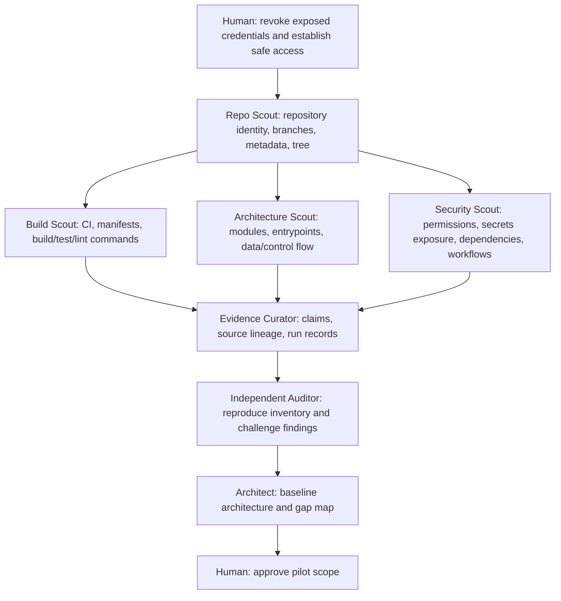

# 13 — Initial Agent Task Graph

This graph is the first execution plan after secure repository access. Tasks A0–A6 are discovery-only; no production code changes are authorized.

## Task assignments

| ID | Role | Depends on | Write access | Output |
|---|---|---|---|---|
| A0 | Human / security steward | — | Credential settings only, manually | Exposure revoked and safe auth status |
| A1 | Repository scout | A0 | None | Repo snapshot, branch/tree map |
| A2 | Build scout | A1 | None | Commands discovered from manifests/CI; baseline runs if safe |
| A3 | Architecture scout | A1 | None | Module/entrypoint/dataflow map with evidence |
| A4 | Security scout | A1 | None; no secret values | Security posture and risk register |
| A5 | Evidence curator | A2,A3,A4 | Report branch only if approved | Claim/evidence/provenance register |
| A6 | Independent auditor | A5 | None | Reproduction and false-PASS challenge |
| A7 | Architect | A6 | Docs branch only after scope approval | ADR candidates and gap map |
| A8 | Human | A7 | Approval authority | Select first implementation pilot |

## Execution constraints

- A1–A4 may run in parallel only after repository identity and read access are established.
- Separate worktrees and outputs are required if parallel agents share a host.
- A5 must not flatten copies into multiple sources; provenance is claim-level where needed.
- A6 must not rely on A5's verdict alone; inspect underlying evidence.
- No task in this graph is authorized to edit source code, change GitHub settings, create secrets, merge, release, deploy, or publish externally.

## Pilot selection rule

Select one narrow issue with: deterministic acceptance, low blast radius, local reproduction, no credentials, no irreversible side effects, and clear rollback. Do not select a broad refactor as the first pilot.
